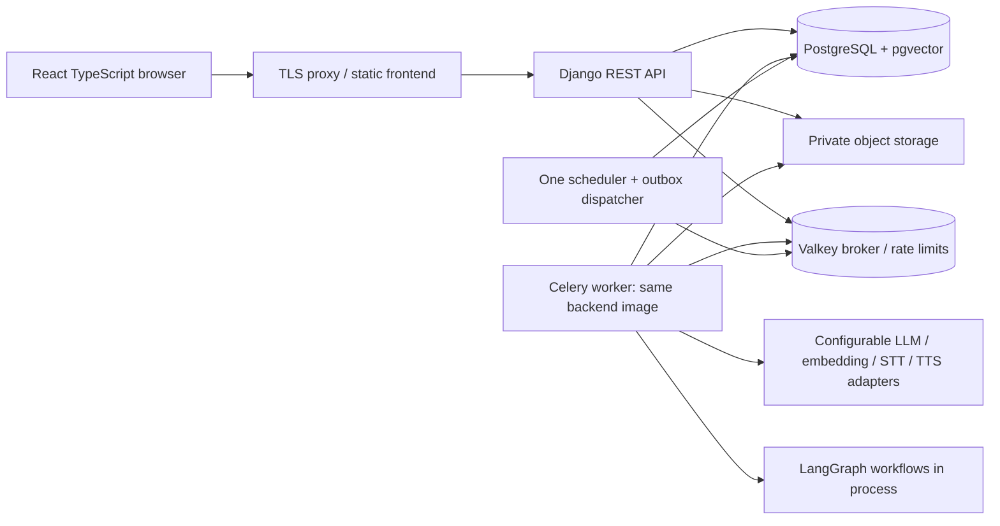
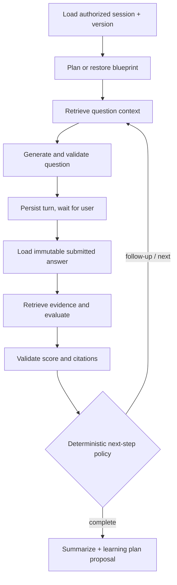

# System architecture

Status: target design, originally 2026-11-24. Backend infrastructure was added on 2026-11-25; domain/AI workflows below remain planned. See [implemented scope](PHASE_1_IMPLEMENTATION.md).

Update 2026-11-26: the user's Phase 2 authentication milestone is implemented with secure server-side sessions, verified email, single-use hashed recovery tokens, versioned owner profiles, candidate/administrator roles and current-data erasure. PostgreSQL-backed authentication email intents are polled by a Celery beat task; Mailpit captures local development mail. This is a bounded authentication queue, not the future generic AI job/outbox service. [Authentication](AUTHENTICATION.md) records migration effects, delivery tradeoffs, security controls and API testing. No JWT, AI features or frontend were added.

## Implemented foundation naming

The current backend follows the user's implementation request: `feedback` maps to this design's proposed `evaluations` module, `ai_services` maps to `ai`, and Redis replaces the initial Valkey proposal. The ten current apps are accounts, resumes, jobs, interviews, feedback, knowledge, learning, analytics, ai_services and common. Separate skills, workflows, media and audit apps are deferred until their domain features need them. The directory tree and topology below describe the broader target, not an inventory of current files. PostgreSQL/pgvector, Redis/Celery, settings, health, schema, logging and tooling are implemented; the planned outbox, React client and identity/privacy workflows are not yet implemented.

## Goals and boundaries

Deliver useful, evidence-backed interview practice while keeping deployment understandable for a small team. Preserve module boundaries, ownership, provenance and reliable state transitions before optimizing scale. Support text first and recorded voice turns later. Personal data remains private to its owner; a separately curated shared corpus supplies technical reference material.

Initial planning load: 100 monthly active users, 1,000 sessions/month, 10 turns/session, 20 concurrently active sessions, and a burst of five AI jobs running at once. Active users often wait or type; concurrency of active sessions is distinct from concurrent inference requests. These are test assumptions, not measured capacity.

## Runtime topology



API validates requests and persists intent; it does not hold an HTTP request open for document processing or model calls. Workers process durable jobs. Polling is the baseline progress transport; SSE and WebSockets are deferred. Object storage serves only short-lived authorized downloads; buckets are private. Deployment may use an S3-compatible managed service; local development can use a private filesystem storage adapter. No mandatory local object-store daemon.

PostgreSQL is the authoritative source of interview, job and billing-budget state. Valkey is disposable transport/cache, never the only record of an answer or a pending task. Logs and metrics are separate operational outputs with redacted payloads.

## Django and React organization

Proposed paths below are design only:

```text
backend/
  config/                 # settings: base/local/test/production, URLs, WSGI/ASGI
  apps/
    common/               # base models, errors, idempotency, storage interfaces
    accounts/             # custom User before initial migration, Profile, consent
    resumes/              # immutable resume versions, extraction and analysis
    jobs/                 # JD versions, skill requirements, gap analysis
    skills/               # taxonomy and evidence-backed observations
    knowledge/            # curated/private sources, chunking, retrieval and ACLs
    interviews/           # sessions, turns, answer state and adaptive policy
    evaluations/          # rubrics, scoring, feedback, citations
    learning/             # plans, tasks, learning resource catalog
    analytics/            # versioned summaries and comparable progress queries
    ai/                   # provider ports, schemas, prompts, run metering
    workflows/            # durable jobs, outbox, LangGraph definitions/checkpoints
    media/                # quarantined uploads, transcription, speech synthesis
    audit/                # security events, export/deletion workflows
  tests/                  # cross-module integration and golden AI datasets
frontend/
  src/
    app/                  # router, providers and application shell
    features/             # auth, profile, resume, jobs, interviews, learning, analytics
    shared/               # API client, accessible components, recorder
docs/
```

Within each app: `models`, `api/serializers`, `api/views`, `services`, `selectors`, `tasks`, and `tests` when needed. Keep small apps simple; split files only when necessary. Views handle transport, services enforce business rules and transactions, selectors encapsulate permission-scoped reads, tasks invoke services. Domain services may call another app's public service; avoid circular model imports, cross-app writes, business logic in signals and generic repository layers over the ORM. CI checks import boundaries. `ai` cannot mutate interview records; `interviews` orchestrates evaluated results through explicit service calls. Shared `common` must not become a domain dumping ground.

React uses route-level features, generated OpenAPI types, TanStack Query for server state, React Hook Form for forms, and semantic accessible components. The server remains authoritative for scores, timing, permissions and transitions. Poll only visible active jobs with backoff and stop at terminal states. Persist draft text locally only with explicit disclosure and clear it on logout; never persist session credentials in localStorage.

## Principal architecture decisions

| ID | Decision | Reason / tradeoff |
| --- | --- | --- |
| ADR-01 | Modular monolith with worker process roles | Shared transactions and simple deployment; extraction requires evidence of independent scaling/ownership |
| ADR-02 | PostgreSQL + pgvector + full-text search | One backup/security boundary; vector workloads need measured resource isolation |
| ADR-03 | Same-origin Django sessions + CSRF | Immediate server-side revocation and no browser JWT storage; mobile/public API auth deferred |
| ADR-04 | Durable async jobs + transactional outbox | Survive broker failure; adds dispatcher/reconciliation logic |
| ADR-05 | Explicit provider interfaces | Local and hosted providers share typed outputs; capability validation still required |
| ADR-06 | Bounded graph, deterministic policy | Explainable control and cost limits; no unrestricted autonomous agents |
| ADR-07 | Versioned inputs, prompts, rubrics, evidence | Reproducible interpretation and fairer trends; retained sensitive artifacts need deletion controls |
| ADR-08 | Recorded voice turns | Browser compatibility and correction before scoring; full-duplex conversational feel deferred |

## Resume, NLP and skill gaps

1. Quarantine upload; verify declared and detected type, size, scan result and parser limits. Parse PDF with pypdf and DOCX with python-docx in a restricted worker. Reject encrypted/unreadable files; scanned PDFs receive an actionable error initially. Optional OCR is a later scoped addition.
2. Normalize text, headings, dates and tokens. Apply spaCy rules/NER and a versioned skill synonym taxonomy. Extract employment/education and skill evidence spans; redact contact details before optional hosted inference.
3. LLM maps ambiguous evidence into a Pydantic-validated schema with source spans, confidence and caveats. It must not invent experience. Users can add labeled corrections; original analysis remains immutable.
4. Analyze pasted JD text into normalized required/preferred skills, importance and requested experience. Do not fetch arbitrary URLs or scrape job boards.
5. Compare approved resume evidence with requirements. Each gap is `evidenced`, `partial`, or `not_evidenced`; missing resume evidence is not proof of missing ability. Weight required=2, preferred=1 initially. Coverage = weighted evidenced fraction, with partial worth 0.5, shown alongside evidence and caveats. Years of experience are extracted observations, not inferred from a keyword. Snapshot analysis/taxonomy versions in the gap report.

## RAG and evaluation

Curators ingest licensed technical documentation, question rubrics and approved learning resources with source URL, license, publication date and review date. No automatic public-web ingestion. Private resume/JD chunks are a separate personalization scope and are never technical truth or shared training data.

Pipeline: validate source -> normalize -> heading-aware chunks (initial target 500 tokens, overlap 75) -> immutable source/chunk IDs and location offsets -> local embedding -> searchable publication. Use a pinned sentence-transformers model revision with a reviewed model card; initial candidate `all-MiniLM-L6-v2` (384 dimensions), subject to domain retrieval benchmarks. Each embedding profile has model, revision, dimension and normalization; queries and vectors must match that profile.

Retrieve using full-text plus cosine similarity inside authorized scope, fuse ranks with reciprocal-rank fusion, and select at most six chunks under a 4,000-token context cap. Start with exact vector search for small filtered collections; introduce HNSW after benchmarks. Similarity thresholds are model/corpus-specific, calibrated on held-out queries. PostgreSQL access filters apply before returned context; ANN filtering can reduce recall and must be tested. pgvector documents exact and approximate indexing and filtering considerations in its [official repository](https://github.com/pgvector/pgvector).

Evaluation receives question, canonical submitted answer, immutable rubric, relevant technical evidence and limited session context. Structured output contains dimension scores (0–4), strengths, improvements, answer excerpts, evidence references, confidence label and abstention reason. Validators check bounds, reference IDs and quoted spans. Compute overall 0–100 as `25 * sum(weight * dimension_score) / sum(weight)`; absent/unscorable dimensions are explicitly excluded and reported. If essential evidence is insufficient, technical factual dimensions remain null and overall is provisional or null, not zero. Provide coaching while explaining unavailable grounding.

Technical rubrics cover correctness, depth, reasoning and clarity. System design adds requirements, tradeoffs, scale and reliability. Behavioral/HR rubrics assess relevance, STAR structure, specificity and reflection; they cannot verify autobiographical truth and do not assign technical correctness based on retrieved prose. Policy and rubric versions define weights per mode. Do not score accents, protected traits, vocal emotion or personality. Visible evidence supports claims; a citation alone does not establish entailment. Human benchmark review is required.

Evaluation is private until the session completes, so follow-ups do not expose reference answers. A complete summary cites retained source snapshots with visible deletion/tombstone status. User corrections before submission are allowed; submitted answers are immutable. Re-evaluation creates a new evaluation revision and preserves the previous revision.

## Adaptive interviews and LangGraph

Create a blueprint from selected track, role, seniority, confirmed skills/gaps, target question count and modality. Technical, behavioral, HR and system-design tracks may be selected separately or mixed with explicit proportions. Start difficulty at the selected seniority band, then adjust by at most one level after two scored primary answers: below 40 reduce, above 80 increase; unscored/provisional answers do not drive difficulty. These thresholds are hypotheses to validate, not psychometric claims.

Limit follow-ups to two per primary question, avoid repeating skill+intent, and reserve primary-question coverage in the total 5–20 question budget. A follow-up probes an observed ambiguity; it must not invent weaknesses or reveal private grading material. User may skip/end; skipped turns are reported and excluded from score averages. Time limits are server enforced; explicit completion can occur early with incomplete coverage disclosed.



Before phase 5, implement the same transitions with ordinary services/tasks. LangGraph later orchestrates these services as nodes: planner, questioner, retriever, evaluator and coach are bounded roles in one process, not separate autonomous services. Graph state holds IDs, versioned decisions, counters and references, with only necessary minimized text. Persist checkpoints in PostgreSQL under a restricted schema and bind server-created thread IDs to owner/session. Persistence supports resume and fault tolerance as described in [LangGraph documentation](https://docs.langchain.com/oss/python/langgraph/persistence).

The user-wait boundary is durable; no worker remains occupied waiting for speech/text. One session execution lease at a time, with heartbeat and fencing token, prevents concurrent graph advancement. Domain state is canonical; checkpoint resumes re-read it. Checkpoint and domain writes are not assumed to be atomic: node effects carry `(session_id, turn_id, operation, version)` unique keys so replay returns the committed result. Provider calls can be billed twice after a crash; persist run attempts and cap retries. Do not claim exactly-once execution.

Initial bounds: 30-second text-provider timeout, at most two transient retries with jitter; 120-second document/STT job timeout; graph step limit 12 per advancement, maximum two schema repair attempts within the shared call budget, and per-session token/spend reservations. Cancellation is cooperative; late results cannot change canceled/deleted sessions. On exhaustion, expose a retryable failure or curated question fallback; do not silently switch vendor or fabricate an evaluation.

## Speech processing

Browser MediaRecorder captures push-to-record audio after consent. Negotiate supported MIME types; accept WebM/Opus and MP4/AAC, validate by decoding with resource-limited FFmpeg, and normalize to mono 16 kHz PCM for STT. Maximum five minutes and 20 MiB per turn; text fallback is always available. No continuous background recording.

STT adapter returns transcript, segments/timestamps, language and optional engine-specific confidence. Confidence is not a calibrated probability; do not compare raw values across providers. User reviews/corrects the transcript and explicitly submits the canonical text for grading. Store original and corrected revisions with provenance; low-confidence text requires review. Local [faster-whisper](https://github.com/SYSTRAN/faster-whisper) is the initial STT candidate; CPU latency must be benchmarked before launch.

TTS synthesizes only stored, authorized question text. Cache by question content hash, voice, locale and model revision, with owner scope for personalized questions. Optional local [Piper](https://github.com/OHF-Voice/piper1-gpl) requires GPL and individual voice model license review; a hosted TTS adapter is an alternative. Browser speech synthesis is a convenience fallback with device-dependent privacy/quality, disclosed before use. TTS failure never blocks text. Do not expose long-lived provider keys or allow arbitrary billable synthesis from clients.

## Learning plans and analytics

Plans combine confirmed gaps and repeated rubric weaknesses with a curator-reviewed resource catalog. Suggest 2–4 weekly objectives and concrete exercises; users control task completion. Link every task to skill/gap or evaluation evidence and a resource. Generated URLs must resolve to catalog entries; no invented courses.

Report track/skill coverage, dimension scores, skipped turns, evidence confidence, and trends by rubric version and difficulty band. Compare like-for-like completed sessions; do not average different rubrics into an unexplained readiness number. Store daily aggregates for speed only after query profiling; raw evaluations remain authoritative and deletions invalidate aggregates. Show sample sizes and no trend with fewer than three comparable sessions. No employability probability or hidden leaderboard.

## Dependencies and provider configuration

| Layer | Proposed baseline | Pin/validation requirement |
| --- | --- | --- |
| Runtime | Python 3.12, Django 5.2 LTS, compatible DRF, psycopg 3 | Latest supported security patches at implementation; validate Python/library matrix |
| API | django-filter, drf-spectacular, django-cors-headers only if needed | OpenAPI generation and typed client compatibility |
| Database | PostgreSQL 17, pgvector with iterative-scan support (0.8+ candidate), pgvector-python | Managed extension availability, backup/restore and migration tests |
| Tasks | Celery 5.x, Valkey with compatible Redis client/protocol | Test actual supported broker combo; do not assume compatibility from naming |
| AI | Pydantic, LangGraph + PostgreSQL checkpoint package, sentence-transformers | Lock compatible releases and model revisions; LangChain integrations optional |
| NLP/documents | spaCy, pypdf, python-docx, ClamAV | Review model/download licenses and parser vulnerabilities |
| Speech | faster-whisper/CTranslate2, FFmpeg; optional Piper | Codec, model, binary and voice license checks; CPU/GPU compatibility |
| Frontend | React, TypeScript, Vite, TanStack Query, React Hook Form | Current mutually compatible stable versions pinned in lockfile |
| Quality/ops | pytest/pytest-django, Ruff, mypy, Vitest, Playwright, OpenTelemetry | No raw prompts in tracing by default |

Django 5.2 is selected for its LTS window rather than a claim to be newest; verify support against the [official release table](https://www.djangoproject.com/download/). No dependency has been installed and no exact patch compatibility is certified by this proposal. Inventory software and model licenses before release.

Provider ports: `generate_structured`, `embed`, `transcribe`, and `synthesize`. Return normalized results plus provider/model/version, latency, usage and error category. Use direct vendor SDK adapters and local adapters; no mandatory paid orchestration service. Configuration concepts: `LLM_PROVIDER`, `LLM_MODEL`, `EMBEDDING_PROFILE`, `STT_PROVIDER`, `TTS_PROVIDER`, provider endpoint allowlist, secret references, timeout, region, capabilities and spend ceiling. A self-hosted OpenAI-compatible endpoint may serve a license-reviewed model through Ollama locally or vLLM on a dedicated GPU when justified. Startup checks reject unsupported structured-output or embedding dimensions. Provider credentials live only server-side. A fallback provider requires an explicit approved data-processing policy and compatible capabilities.

## Infrastructure and reliability

Local development: Docker Compose planned for API, frontend, PostgreSQL/pgvector, Valkey, worker and optional scan/STT profiles; 16 GB RAM and 4+ CPU recommended for local NLP/STT, with disk space for model weights. CPU local LLM performance is not promised. CI uses deterministic fake providers; optional paid benchmark jobs have a fixed budget.

Pilot production: one TLS origin/static frontend, 2-vCPU/2–4-GB API, 2-vCPU/4–8-GB worker, managed PostgreSQL with pgvector (2–4 GB initial RAM), small private broker, private object storage, transactional email, secrets manager, malware scanner, metrics and backup storage. Scanner/model processes may require the upper RAM range. Bound inference concurrency to provider quotas and worker RAM; split CPU-heavy tasks into separate queues/process pools within the same image if measurements require it. Five concurrent CPU STT jobs likely exceed a small pilot worker: queue them or add a measured speech worker process.

Use health/readiness checks, connection pooling, graceful shutdown, separate document and interactive queues, dead-letter-style failed job records and retry tooling. A transactional outbox stores task intent in the same commit as domain changes; dispatcher publishes at least once and retries until acknowledged. A reconciliation job finds stuck/expired leases and resumes eligible work. Scheduler is singleton/leader leased. Broker outage leaves durable jobs pending and exposes degraded status.

Deploy through CI-built immutable non-root images. Run backward-compatible expand/migrate/contract database changes as a controlled release job; API/workers must tolerate adjacent schema versions. Back up PostgreSQL including vectors/checkpoints, object storage, and encryption-key configuration. Target pilot RPO 24 hours/RTO 8 hours with daily backups; production gate improves to RPO 1 hour/RTO 4 hours with tested point-in-time recovery and object versioning/lifecycle rules. One API instance is a pilot single point of failure; production availability requires at least two instances and managed database failover, not just replicas of the UI.

Observability: request/job/run correlation IDs, queue age, retry counts, provider timeouts/429s, token/audio cost, citation validation, abstentions, pipeline durations, database saturation and deletion backlog. Alert on queue age >60 seconds for interactive work, provider error rate >5% over 10 minutes, budget 80%/100%, and overdue deletion. Log identifiers and operational metadata, not resumes, answers, audio, credentials or hidden reasoning.

## Operational cost model

Budget date: 2026-11-24; USD/month, before tax. These are engineering planning assumptions, not exact vendor offers. Hardware sizing and concurrency can force higher tiers. See [Render pricing](https://render.com/pricing) for an example managed-hosting rate card and [OpenAI pricing](https://developers.openai.com/api/docs/pricing) for an example hosted-inference rate card. Validate model availability, rate limits, region and current quotes before purchase. Free tiers are suitable for demos, not the reliability/retention commitments below.

Assume 1,000 sessions x 10 turns. Budget **all question generation, evaluation, follow-ups, summaries and extraction** at 80,000 billed input tokens and 12,000 billed output tokens per session (80M/12M monthly). This must include repeat context and reasoning tokens where billed; benchmark actual use. For illustration use hypothetical affordable-provider budget rates of $0.50/M input and $2/M output: `80 * 0.50 + 12 * 2 = $64`. These rates are assumptions, not attributed vendor prices. Add 30% retries/variance -> approximately $83. A provider charging $2/$8 would instead cost $256 before contingency, $333 after it. Enforce reservations, not merely retrospective reports.

Voice scenario: 30% of sessions, each with 15 minutes user audio and 5 minutes generated question audio: 4,500 STT minutes and 1,500 TTS minutes/month. At hypothetical budget rates $0.006/STT minute and $0.02/TTS minute, voice costs $27+$30=$57. Actual billing may use characters/tokens rather than minutes; convert from measured speech rates. At 32 kbit/s, 6,000 stored audio minutes would be about 1.44 GB; uncompressed intermediates are much larger and deleted promptly. Retention and downloads affect storage/egress.

| Monthly line item | Pilot budget range | Notes |
| --- | --- | --- |
| API + static hosting | $20–50 | Single pilot API; redundancy costs more |
| General/CPU worker and scanner | $30–100 | Local embedding and limited STT; benchmark memory |
| Managed PostgreSQL + backup allowance | $25–80 | Extension/PITR availability must be checked |
| Broker | $10–25 | Private paid instance |
| Object storage + egress | $5–15 | Short-lived audio and resume files |
| Email, domain, logs/metrics | $10–35 | Volume and retention dependent |
| Infrastructure subtotal | **$100–305** | Excludes GPU, staging and engineering labor |
| Hosted text at example low budget | ~$83 | Includes 30% contingency |
| Hosted voice scenario | ~$57 | No voice contingency included |
| Pilot total with 20% voice contingency | **~$252–457** | Infra + 83 + 68.4; round monthly budget to $250–460 |

Local embeddings have compute cost already in worker budget. Hosted embedding cost, if selected, is `new+query tokens / 1M * provider rate` and must be added; reindexing is a separate burst. An all-local text/voice route can remove per-call fees but may need a dedicated GPU: plan an additional **$300–1,000+/month** as a procurement allowance, not a measured quote. Do not assume local inference is cheaper at this traffic. Staging, production redundancy, managed failover, stronger monitoring and higher volumes justify a separate **$500–1,500+/month infrastructure allowance**, excluding inference. No linear scaling claim: benchmark database, queues and provider limits at each growth step.

## Deferred complexity and scaling triggers

Profile before adding components. Add worker capacity when queue-age targets fail after tuning. Introduce HNSW when exact retrieval breaches latency targets. Consider a read replica when analytics measurably harms transactions. Consider a dedicated speech/GPU deployment only with sustained utilization and a stable adapter boundary. Extract a service only when independent lifecycle, isolation or scaling measurably outweighs distributed failure and authorization complexity. No Kafka, Kubernetes, vector SaaS, fine-tuning or multi-region write model initially.
