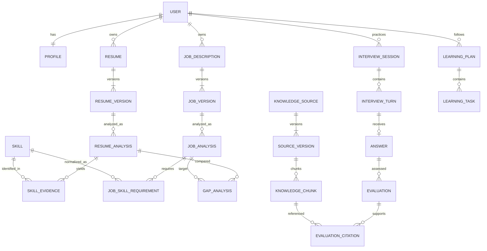

# Database design

Status: proposed PostgreSQL relational model; no migrations exist. App ownership follows [architecture](ARCHITECTURE.md). Use PostgreSQL 17 with pgvector, subject to deployment compatibility testing.

## Conventions and ownership

Domain primary keys are UUIDs; timestamps are UTC `timestamptz`. Tables have `created_at`; mutable records also have `updated_at` and integer `version` for optimistic concurrency. JSONB stores versioned model outputs/configuration, never replaces core foreign keys or indexed authorization fields. Monetary amounts use integer micro-USD; scores use bounded decimal, never floating-point money. Keep human-readable enum strings with database checks.

Every private aggregate has an `owner_id -> accounts_user`. Children inherit ownership through a required FK path; denormalize owner only when query performance requires it, with consistency enforcement. A supplied UUID never grants access. Cross-owner associations (resume/JD/session, answer/media, plan/session) are rejected in services and protected by composite unique keys/FKs `(id, owner_id)` where stored on both sides. Django migrations may need explicit SQL for composite FKs; test this before rollout. A simple FK alone does not enforce owner equality.

Default `on_delete=PROTECT` for versioned source references so ordinary deletes cannot break provenance; deletion workflows explicitly remove private dependents in dependency order. Pure child tables use `CASCADE` only within the same privacy lifecycle. Public reference removal creates a tombstone; private content must actually be purged. Soft-deletion is an immediate visibility mechanism, not fulfillment of erasure. Technical identity tables such as Django sessions and library checkpoint tables follow their package schema but are included in lifecycle and access reviews.

## Entity relationships

Cardinality `0..1` answer per turn means one immutable submitted answer; separate draft/transcript revisions are not submitted answers. Generation failure may leave a session temporarily with zero turns. A resume or JD logical record is committed together with its first version.

## Accounts, files and analysis

| Table (app) | Main columns and relationships | Constraints / lifecycle |
| --- | --- | --- |
| `accounts_user` | Custom Django user, normalized email, password hash, is_active, email_verified_at, deletion_requested_at | Unique case-insensitive email; account IDs never reused; custom user before first migration |
| `accounts_profile` | user PK/FK, display_name, timezone, locale, target_role, seniority, preferences JSONB | Exactly one per user; no unnecessary demographic fields |
| `accounts_consent` | user, purpose, policy_version, granted_at, revoked_at | Immutable consent events; purposes distinguish hosted processing, recording, optional audio retention |
| `accounts_auth_token` | user, purpose, token_hash, expires_at, consumed_at | Unique token hash; verification/reset only; short-lived, single use; no plaintext token |
| `media_asset` | owner, purpose, storage_key, original_name, detected_type, byte_size, sha256, scan_status, state, expires_at, deleted_at | Key unique; positive bounded size; quarantine/clean/rejected/deleted; never publicly addressable |
| `resumes_resume` | owner, label, current_version_id, deleted_at | Current version must belong to this resume; validate with constraint trigger or service + locked transaction |
| `resumes_version` | resume, version_number, asset_id, extracted_text, text_hash, extraction_version | Unique(resume, version_number); immutable after successful extraction; text is sensitive |
| `resumes_analysis` | resume_version, owner, ai_run_id, schema_version, taxonomy_version, structured_result, status | Append-only analysis attempts; unique successful idempotent request key; no overwritten analysis |
| `jobs_description` | owner, label, current_version_id, deleted_at | Same version ownership invariant as resumes |
| `jobs_version` | job_description, version_number, title, company_optional, raw_text, text_hash | Unique(job_description, version_number); pasted text only initially |
| `jobs_analysis` | job_version, owner, ai_run_id, taxonomy_version, structured_result, status | Immutable successful result |
| `skills_skill` | canonical_name, slug, category, active | Unique slug; curated taxonomy, not arbitrary model-created IDs |
| `skills_alias` | skill, alias_normalized, taxonomy_version | Unique(alias_normalized, taxonomy_version) |
| `skills_evidence` | resume_analysis, skill, evidence_start, evidence_end, snippet, source_type, confidence_label, asserted_level_optional | Valid text offsets; unique analysis/skill/span; source_type extracted/user_confirmed; level is a claim, not certified ability |
| `jobs_skill_requirement` | job_analysis, skill, priority, minimum_years_optional, evidence_start/end | Unique(job_analysis, skill); priority required/preferred; years >=0 |
| `jobs_gap_analysis` | owner, resume_analysis, job_analysis, algorithm_version, taxonomy_version, coverage, result, ai_run_id_optional | Coverage 0–100; snapshot references; immutable |
| `jobs_gap_item` | gap_analysis, skill, state, importance, explanation | Unique(gap_analysis, skill); state evidenced/partial/not_evidenced |
| `jobs_gap_item_evidence` | gap_item, skill_evidence | Unique(gap_item, skill_evidence); evidence must belong to the gap's resume analysis |

User-confirmed corrections are appended as labeled skill evidence plus a new analysis revision, not destructive edits of extracted evidence. The explicit gap evidence join preserves FK integrity; services additionally enforce that the linked evidence belongs to the compared analysis.

## Knowledge and vector storage

| Table | Main columns | Constraints / indexes |
| --- | --- | --- |
| `knowledge_source` | scope(shared/private), owner_nullable, kind, canonical_url_optional, title, license, visibility, deleted_at | shared => owner NULL; private => owner NOT NULL; curator publication required for shared |
| `knowledge_source_version` | source, version_number, content_hash, normalized_text, published_at, reviewed_at, ingestion_status, origin_resume_version_id_optional, origin_job_version_id_optional | Unique(source, version_number); private source has exactly one appropriate origin when derived from resume/JD; prevent shared/private origin mismatch |
| `knowledge_chunk` | source_version, ordinal, content, heading, start_offset, end_offset, content_hash, search_tsvector | Unique(source_version, ordinal); offsets checked; GIN on search_tsvector |
| `knowledge_embedding_profile` | name, provider, model, revision, dimension, normalization, distance, status | Profile immutable once vectors exist; unique fingerprint |
| `knowledge_chunk_embedding_384` | chunk, profile, embedding `vector(384)` | Unique(chunk, profile); profile dimension=384; cosine index when warranted |
| `knowledge_retrieval_run` | ai_run, profile, query_hash, authorized_scope_snapshot, fusion_version, selected_chunk_ids, scores | Trace metadata only by default; raw queries treated as sensitive if retained |

Do not mix incompatible embeddings even when dimensions happen to match. Candidate initial profile uses 384-dimensional local embeddings; switching to a 1,536-dimensional hosted model introduces a **separate typed embedding table/index**, not a column silently resized in place. Re-embed into a new profile, evaluate, atomically switch active profile, keep old profile while in-flight sessions need it, then retire/purge. Never compare queries from profile B with vectors from A.

Shared and owner-private retrieval run as explicitly scoped queries, then fuse authorized results. Private rows never enter a global shared candidate pool. Start exact search; add HNSW `vector_cosine_ops` when measured need justifies it. Scope/source/owner B-tree indexes support filtering; ANN can underfill after filters, requiring iterative scans or exact scoped fallback. Verify plans and recall with real tenant distributions. Avoid premature partitioning.

## Interviews and evaluations

| Table | Main columns / foreign keys | Constraints / notes |
| --- | --- | --- |
| `interviews_session` | owner, resume_analysis_optional, job_analysis_optional, gap_analysis_optional, track_mix, seniority, modality, requested_question_count, blueprint JSONB, state, started_at, ended_at, expires_at, policy_version, version | 5–20 requested turns; state draft/preparing/active/completing/completed/canceled/failed; modality text/voice; snapshot all referenced versions |
| `interviews_turn` | session, ordinal, parent_turn_optional, skill_optional, category, difficulty, question_text, question_context JSONB, rubric_version, state, generated_run_id | Unique(session, ordinal); ordinal>0; parent in same session and earlier ordinal; at most two children per primary enforced under session lock; state awaiting_answer/submitted/evaluating/evaluated/skipped/failed |
| `interviews_answer` | turn unique, text, source(text/transcript), transcript_revision_optional, submitted_at, client_request_id | One immutable submitted answer per turn; max 20,000 characters; transcript belongs to turn/session owner |
| `media_transcription` | owner, turn, media_asset, ai_run, status, language, raw_text, segments JSONB | STT result immutable; asset purpose=answer_audio and same turn owner |
| `media_transcript_revision` | transcription, revision_number, text, edited_by_user, created_at | Unique(transcription, revision_number); submitted revision cannot mutate |
| `media_speech_output` | turn, media_asset, ai_run, voice, locale, content_hash, model_revision | Unique authorized cache fingerprint; only stored questions are synthesized |
| `evaluations_rubric_version` | rubric_key, version_number, category, dimensions JSONB, weights JSONB, scale | Unique(rubric_key, version_number); immutable published rubric; weights positive and sum policy validated |
| `evaluations_evaluation` | answer, revision_number, rubric_version, ai_run, status, overall_nullable, confidence_label, abstention_reason, feedback JSONB, is_current | Unique(answer, revision_number); partial unique one current completed evaluation per answer; overall 0–100 or NULL |
| `evaluations_dimension_score` | evaluation, dimension_key, score_nullable, weight, rationale, answer_excerpt | Unique(evaluation, dimension_key); score 0–4 or NULL; verify dimension exists in rubric |
| `evaluations_citation` | evaluation, dimension_key_optional, chunk, quoted_text, start_offset/end_offset, entailment_status | Offsets and quote match immutable chunk; citations only to authorized retained sources |
| `interviews_summary` | session, revision_number, aggregate_schema_version, evaluation_set_hash, summary JSONB, ai_run_optional | Unique(session, revision_number); immutable input evaluation IDs; latest current pointer on session |

Category enum: technical/behavioral/hr/system_design. Difficulty: beginner/intermediate/advanced with defined policy mapping to selected seniority. Scores are not comparable across categories or rubric versions without an explicit normalization study.

PostgreSQL checks enforce scalar ranges and unique keys. Cross-row rules (turn count, follow-up budget, same-session parent, current pointers, owner equality, rubric dimension membership) require locked service transactions and/or constraint triggers; acceptance tests must exercise direct SQL paths for rules claimed as database-enforced. Do not describe an application validator as a database guarantee.

## Learning, analytics and runtime bookkeeping

| Table | Main columns / relations | Constraints / role |
| --- | --- | --- |
| `learning_resource` | title, URL, skill, kind, license, reviewed_at, active | Curator-approved catalog; outbound URLs allowlisted/reviewed |
| `learning_plan` | owner, source_session_optional, source_gap_optional, revision, status, objectives, ai_run | At least one source; immutable proposal, lifecycle draft/active/archived |
| `learning_task` | plan, skill, resource_optional, source_evaluation_optional, source_gap_item_optional, title, exercise, due_date_optional, status, completed_at | status todo/in_progress/done; evidence reference and explanation required |
| `analytics_daily_metric` | owner, date, track, skill_optional, difficulty, rubric_version, schema_version, sample_count, aggregate JSONB | Unique normalized dimensional key; nonnegative counts; derived and rebuildable |
| `ai_run` | owner_nullable, purpose, provider, model, revision, prompt_version, schema_version, input_hash, status, latency_ms, usage JSONB, cost_micro_usd, job_id | Per logical model operation; private run owner required; no secrets or full prompts by default |
| `ai_run_attempt` | run, attempt_number, started_at, ended_at, provider_request_id_optional, outcome, usage, estimated_cost | Unique(run, attempt_number); distinguish retry billing from logical runs |
| `workflows_job` | owner, kind, resource_type, resource_id, state, progress, error_code, attempts, lease_token, lease_expires_at, cancel_requested_at, expires_at | pending/running/succeeded/failed/canceled; generic reference validated against allowlisted resource types; index(state, lease_expires_at) |
| `workflows_outbox` | job, event_key, payload_ids JSONB, published_at, attempts, next_attempt_at | Unique event_key; persisted with domain change; index unpublished/next_attempt |
| `workflows_operation` | session, turn_optional, operation_name, version, result_reference | Unique normalized operation key; replay deduplication; no NULL uniqueness loophole for session-only operations |
| `workflows_thread` | owner, session unique, graph_version, server_thread_id unique, last_checkpoint_id, lease/fencing metadata | Checkpoint tables in restricted schema, JSON-safe serialization only; purge with session |
| `common_idempotency_record` | owner_or_auth_scope, route, key_hash, request_hash, response_status, response_body_minimized, resource_id, expires_at | Unique(scope, route, key_hash); 24h replay window; no raw sensitive response bodies |
| `ai_budget_bucket` | scope(user/global), owner_nullable, period_start, period_end, limit_micro_usd, reserved_micro_usd, spent_micro_usd | user => owner required; global => owner NULL; unique scope/owner/period with NULL-safe global uniqueness; lock both scopes in fixed order to reserve/settle/release |
| `audit_event` | actor_nullable, subject_pseudonym, action, resource_type, resource_pseudonym, outcome, request_id, metadata_allowlist | Append-only restricted log; no resume/answer/audio content |
| `audit_privacy_request` | owner_nullable, subject_pseudonym, kind, state, requested_at, due_at, artifact_id_optional, completed_at | export/deletion; minimal evidence retained after owner erasure |

Generic job references intentionally avoid a sprawling nullable FK set. A service allowlist and periodic orphan check enforce lifecycle; if stronger referential integrity is required, add typed relation tables before exposing new job kinds. External state such as object storage cannot be protected by PostgreSQL FK alone.

## Transactions and state transitions

Session flow: `draft -> preparing -> active -> completing -> completed`; nonterminal states may become canceled or failed. First question creation completes preparation. Answer submission locks session and current turn, verifies expected version/awaiting state, inserts answer, advances turn to submitted, writes job/outbox and commits. Evaluation success marks evaluated, commits the immutable result and queues one advancement. Only the advancement operation creates the next turn or summary. Session remains active while evaluating; current action in API indicates the wait.

Turn skip applies only to awaiting_answer under the same lock. Completion rejects while an accepted turn evaluation is still running unless user explicitly cancels; completion is asynchronous and idempotent. Time expiry moves to completing after settling accepted work; no additional turns accepted past server expiry. Cancellation fences late writes and releases reservations once attempts settle.

Use short `transaction.atomic` blocks and `select_for_update` around transitions; provider/network work happens outside transactions. Worker commits use expected version/fencing token checks. Concurrent answer/skip/end requests cannot create two answers or two next turns. Outbox dispatch and model inference are at least once; deduplication makes domain effects effectively once. Budget reservations are locked before model dispatch and settled per attempt; reconcile abandoned leases and outstanding reservations.

## Indexing, retention and migrations

Index `(owner_id, created_at DESC, id)` for private list endpoints; session state/expiry, turn `(session_id, ordinal)`, answer/evaluation FK, job state/lease, and source scope/owner. PostgreSQL does not automatically index every referencing FK: add measured join/deletion-path indexes. Use `EXPLAIN ANALYZE` on representative datasets. Add daily aggregates only after profiling, not as a first dependency.

Retention defaults are in [security](SECURITY.md#retention-and-deletion). Delete source files, extracted text, private chunks/vectors, transcripts, checkpoints, evaluation excerpts, learning/analytics derivatives and cached results together when their private source is erased. Do not keep a shadow copy in AI traces or idempotency responses. Source deletion invalidates dependent reports and active sessions; retain only minimal content-free tombstones if necessary. Account deletion sweeps all private aggregates and storage objects, revokes sessions and queued work, and records minimal completion evidence.

Migrations are forward-tested on empty and previous-release schemas. Add nullable/new structures first, backfill in bounded resumable batches, then validate constraints and change readers; destructive removal occurs in a later release. Create large indexes concurrently outside atomic migrations. Back up and restore-test vectors, extensions and checkpoints. Restore workflows replay erasure tombstones before serving restored data; backups age out on policy rather than silently retaining personal data forever.
